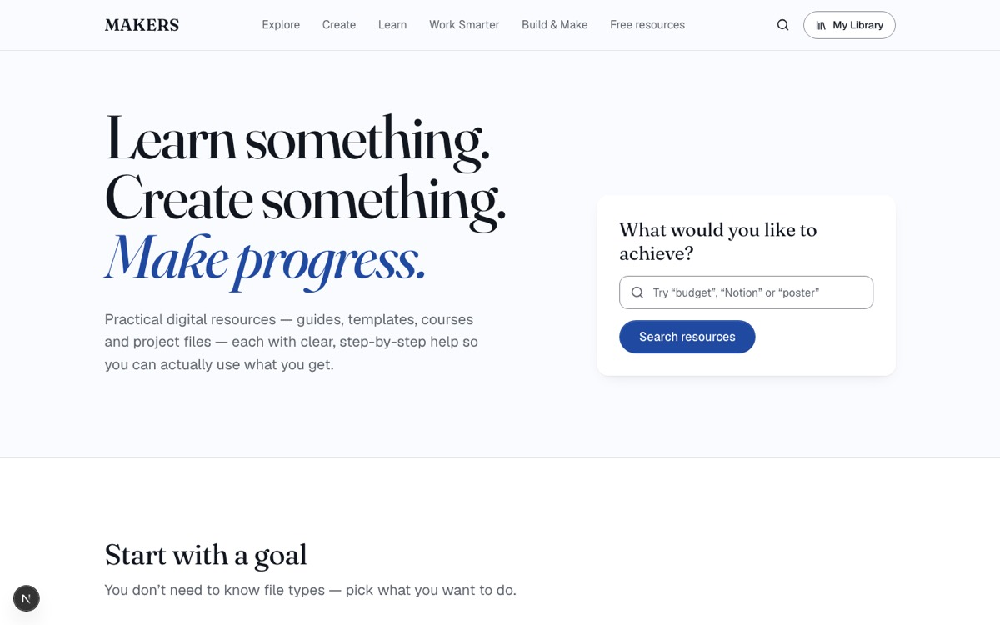
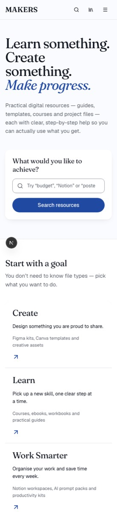
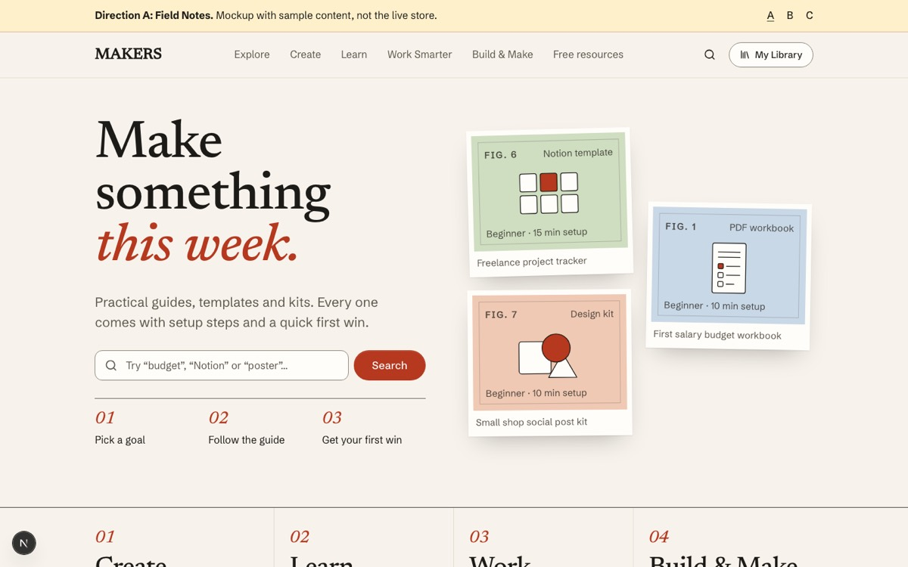
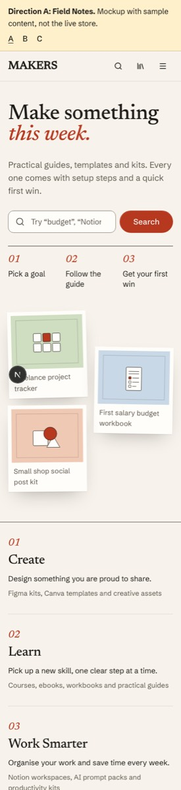
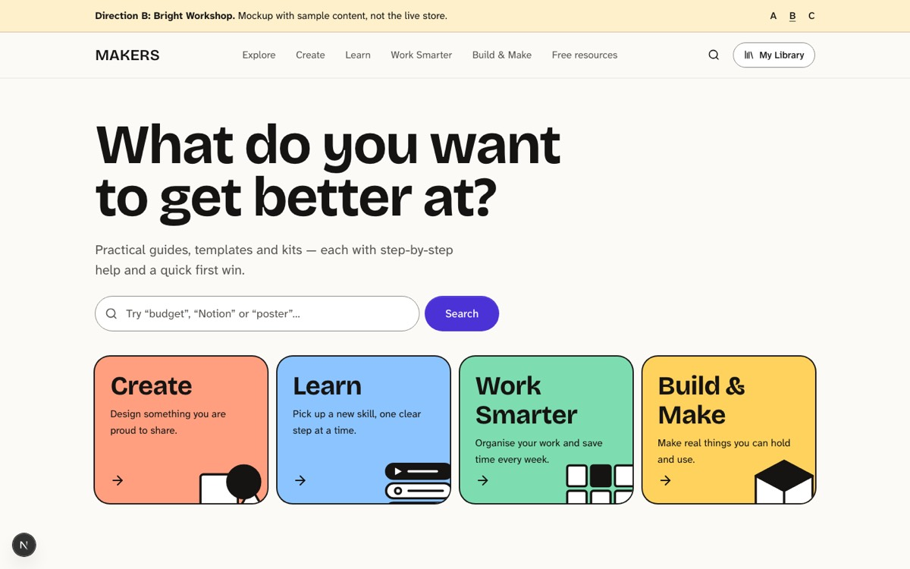
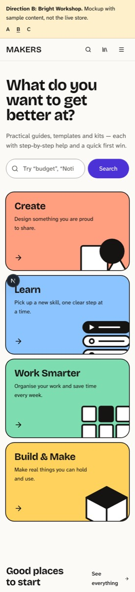
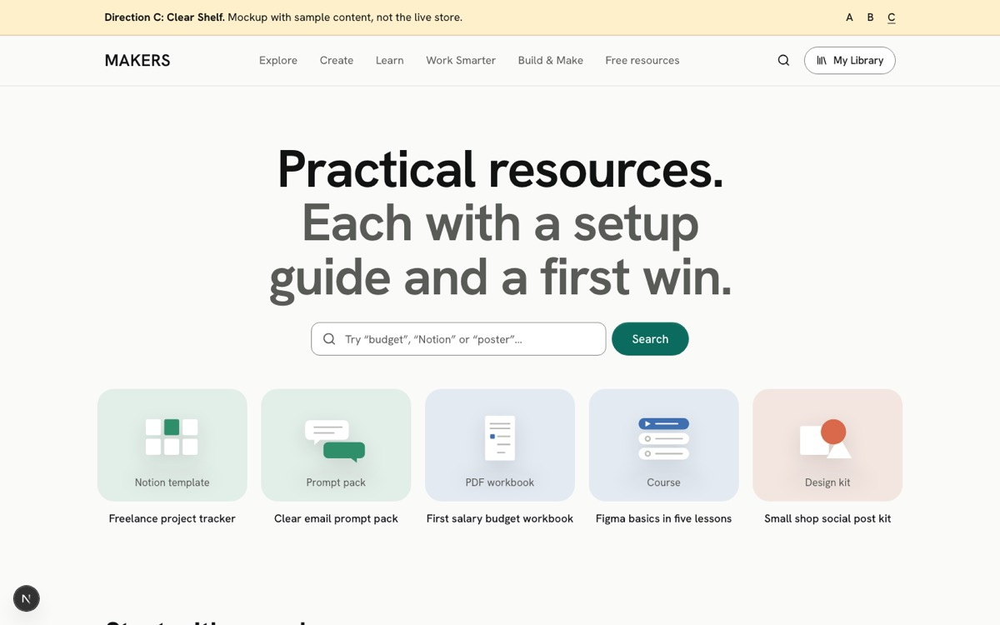
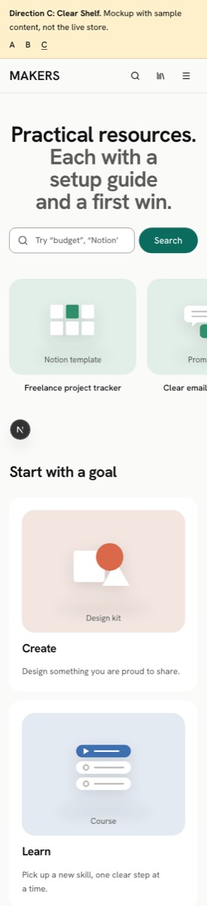

# Three design directions: pick A, B or C

Built 2026-11-18 from [`UI_AUDIT.md`](UI_AUDIT.md) and [`INSPIRATION.md`](INSPIRATION.md).

**See them live:** run `npm run dev`, then open `/design-preview/directions/a`, `/b` and `/c`. Each page shows:

- a hero
- goals
- product cards
- a product-page sketch with the phone buy bar
- all 9 cover types
- palette, type and motion notes

The pages use sample (seed) content, are hidden from search engines and return **404 on production**.

**Rules every direction keeps:**

- Honest content only. No ratings, sales counts, scarcity or stock photos. Covers show only real facts.
- Plain English.
- 16px+ body text, AA contrast (all pairs below were measured), keyboard access and focus rings.
- Reduced-motion support, and UI motion of 300 ms or less.
- No layout shift (layout-matching skeletons are in every option).
- Fonts are free (SIL Open Font License via `next/font`) and much lighter than today's.

|                             | Today                             | **A: Field Notes**                                                                                     | **B: Bright Workshop**                                                                                                                                                                           | **C: Clear Shelf**                                                      |
| --------------------------- | --------------------------------- | ------------------------------------------------------------------------------------------------------ | ------------------------------------------------------------------------------------------------------------------------------------------------------------------------------------------------ | ----------------------------------------------------------------------- |
| Feeling                     | Tidy, generic                     | A well-made workbook                                                                                   | A cheerful maker space                                                                                                                                                                           | A calm product shelf                                                    |
| Accent                      | Ink blue `#2049a1` (temporary)    | Vermilion `#b5381f` (white text 5.9:1)                                                                 | Ultramarine `#4b32d6` (7.7:1)                                                                                                                                                                    | Deep teal `#0b6b5e` (6.4:1)                                             |
| Surfaces                    | Cool white                        | Warm paper `#f7f3ec`                                                                                   | Off-white + 4 bright goal colours                                                                                                                                                                | Cool white + pale stages                                                |
| Headlines                   | Fraunces                          | Newsreader 500 + italic                                                                                | Bricolage Grotesque                                                                                                                                                                              | Hanken Grotesk 650                                                      |
| Reading text                | Geist                             | Schibsted Grotesk                                                                                      | Atkinson Hyperlegible Next                                                                                                                                                                       | Hanken Grotesk                                                          |
| Fonts downloaded (measured) | **395 KB**                        | 94 KB (≈129 KB with ₹ prices*)                                                                         | 73 KB (≈110 KB with ₹*)                                                                                                                                                                          | 34 KB (≈53 KB with ₹*)                                                  |
| Signature hero              | 3-sentence headline + search card | "Open workbook": short serif line, inline search, 3 real covers as numbered plates, 3-step margin note | "Goal bento": big question, big search, four bright goal tiles                                                                                                                                   | "The shelf": two-tone headline, search, a row of real covers on a stage |
| Cover system                | Pale tint + small icon            | Figure plates: technical line drawing, one vermilion part, "FIG. n"                                    | Cut-paper: bold outlined shapes on full colour, sticker label                                                                                                                                    | Soft white objects on a tinted stage, floor shadow                      |
| Motion                      | Hover and dialog only             | "Paper": settled, no bounce                                                                            | "Springy": stiff springs, small pops                                                                                                                                                             | "Glide": smooth, Apple-like                                             |
| Draws on                    | —                                 | Making Software, Every, Craft, Are.na, Siteinspire                                                     | Gumroad, Notion templates, Maven, Lemon Squeezy, Godly                                                                                                                                           | Apple buy page, Things, Framer template page, Linear, Stripe            |
| Main risk                   | Looks AI-made                     | Serif-on-cream is a known editorial look; the drawn plates must carry it                               | Loudest; four colours will fight with real cover photos; can drift to "playful SaaS". The body font has no size-matched fallback in Next.js, so there's a small layout-shift risk while it loads | Safest and fastest, but closest to a generic clean store                |

\* The ₹ sign sits in each font's "latin-extended" file, so pages that show prices download one more small file per font. A can get under 120 KB with ₹ by loading one fewer weight (planned if A is picked).

## Screenshots (first screen, local dev, sample content)

|                    | Desktop 1440                                      | Phone 390                                      |
| ------------------ | ------------------------------------------------- | ---------------------------------------------- |
| Today              |  |  |
| A: Field Notes     |        |        |
| B: Bright Workshop |        |        |
| C: Clear Shelf     |        |        |

## Motion language, in numbers

|                          | A: Field Notes                                                               | B: Bright Workshop                                    | C: Clear Shelf                     |
| ------------------------ | ---------------------------------------------------------------------------- | ----------------------------------------------------- | ---------------------------------- |
| Press / hover feedback   | 120 ms, ease-out `(0.23, 1, 0.32, 1)`                                        | stiff spring, ~250 ms settle, under 2% overshoot      | 140 ms ease-out                    |
| Dialog / sheet / buy bar | 240 ms                                                                       | 260 ms spring                                         | 280 ms `(0.32, 0.72, 0, 1)`        |
| Scroll entrance (once)   | fade + 8 px, 260 ms, 40 ms stagger                                           | 12 px, 280 ms, 50 ms stagger                          | fade + 12 px, 300 ms               |
| Card → product           | Cover plate grows into the product cover (React `<ViewTransition>`, ~260 ms) | Same, ~260 ms                                         | Same, ~280 ms (its signature move) |
| Lists and filters        | Crossfade + layout shift-free reflow                                         | Chips pop 160 ms, list reorders with layout animation | Crossfade                          |
| Reduced motion           | Fades only                                                                   | Fades only, no springs                                | Fades only                         |

All of them use `framer-motion` through `LazyMotion` + `m` (the smallest bundle), and CSS where CSS is enough. Browsers without View Transitions simply navigate normally.

## Recommendation: **A: Field Notes**

1. **It matches what MAKERS sells.** The store's promise is "a guide with every resource" and "a first win". A workbook and manual look says _we teach you_, not just _we sell files_. The figure-plate covers turn every product type into a clear, honest drawing that explains what you get.
2. **It is the most ours.** B leans on the bright-tile look many template shops use, and C is closest to a generic clean store. A's plates, numbering (01 / 02 / 03, FIG. 6) and the italic "this week." moment give a voice nobody else in the research has, without fake data.
3. **It works for beginners worldwide.** Warm paper and a book serif feel calm and trustworthy. The reading face is plain, and the vermilion accent stands out on a phone without shouting.
4. **It fixes performance.** Fonts drop from 395 KB to about 94–129 KB.

**Choose B instead** if you want the store to feel young and playful above all. **Choose C** if you want the fastest, quietest store and plan to upload your own cover images soon.

## What happens after you pick

These are the step-5 items from your brief, built in the chosen style:

- palette-tier token update, new fonts
- cover system for all 9 product types
- Home hero and section rhythm
- framer-motion (entrances, card → product, filters, dialogs, buy bar, press feedback, layout-matching skeletons)
- empty states and microcopy
- polish of Explore, the product page, My Library and the claim and checkout dialogs
- `docs/DESIGN.md` motion and design guide

This preview route is deleted at the end; it is a decision tool, not part of the store.
